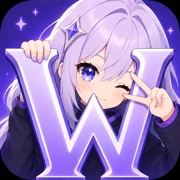
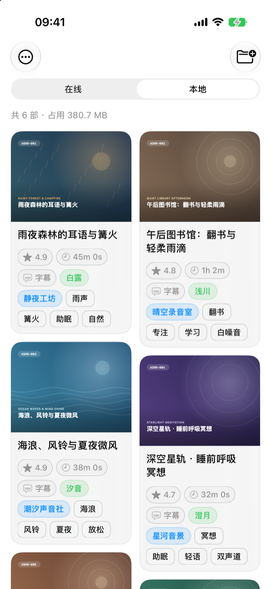
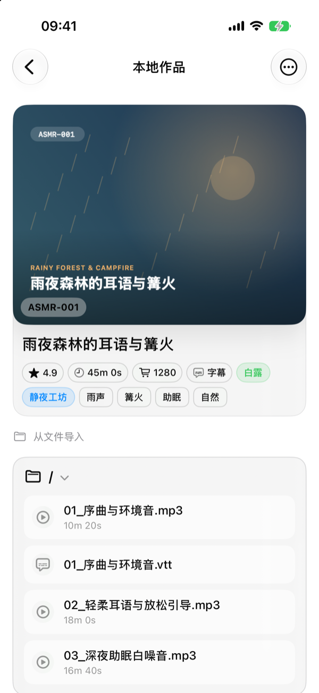
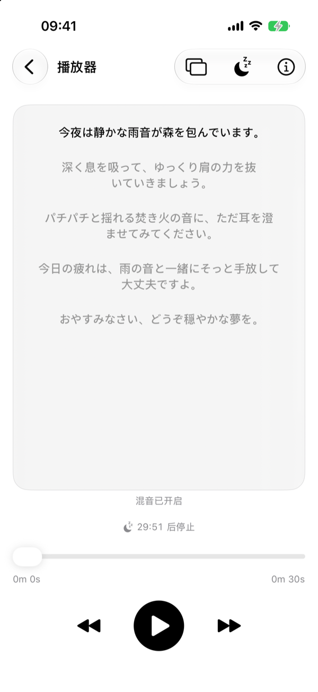
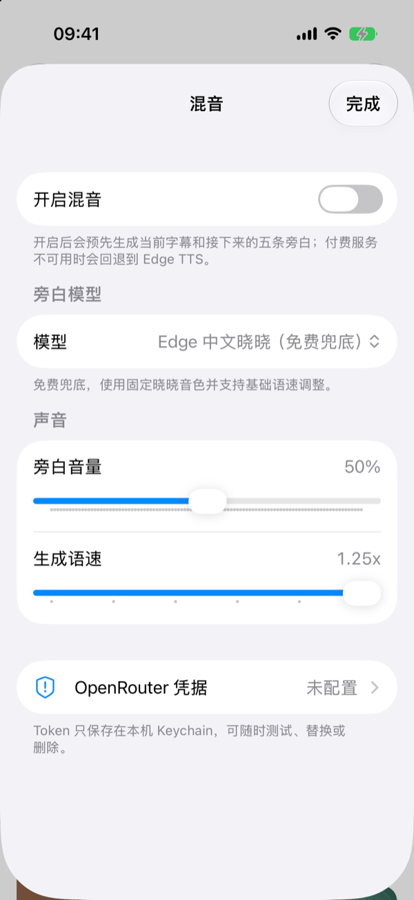

<div align="center">



# Wisimi

**原生 SwiftUI 打造的 iOS ASMR 播放器**  
支持 [asmr.one](https://asmr.one) 在线浏览与本地作品导入，内置实时字幕同步与 AI 中文旁白

[](https://github.com/wsmbsbbz/Wisimi/releases)
[](https://developer.apple.com/ios/)
[](https://developer.apple.com/xcode/swiftui/)
[](LICENSE)

[English](README_EN.md) · [核心特性](#核心特性) · [界面预览](#界面预览) · [本地作品导入](#本地作品导入) · [开发与验证](docs/DEVELOPMENT.md) · [更新记录](CHANGELOG.md)

</div>

---

Wisimi 专注于为移动端 ASMR 聆听提供更顺滑的原生体验：在兼容 asmr.one 丰富内容的同时，补齐了**实时中文 TTS 旁白**、**音视频混合队列**、**本地文件夹导入**与**后台批量下载**等面向日常听音场景的功能。

## 界面预览

| 本地与在线作品库 | 作品详情与相似推荐 | 播放器与实时中文旁白 | 旁白音色与混音设置 |
| :---: | :---: | :---: | :---: |
|  |  |  |  |

## 核心特性

### 1. AI 中文实时旁白
- **开箱即用**：读取 VTT / LRC 字幕，在播放原声的同时叠加中文 TTS 旁白（免费方案基于 Edge 语音服务）。
- **进阶音色支持**：支持填写个人 OpenRouter Token，调用 `minimax/speech-2.8-turbo`、`minimax/speech-2.8-hd` 与 `google/gemini-3.1-flash-tts-preview`。
- **精细化听感控制**：MiniMax 仅精选 6 种适合 ASMR 的女声，支持 0.5x–2.0x 语速、表达预设，以及句内停顿、呼吸、叹息、哼唱等自然效果；OpenRouter 异常时自动回退免费服务。

### 2. 原生影音播放与字幕交互
- **音视频混合队列**：同目录内的音频与 MP4 视频自动组成连续播放队列，支持上一首 / 下一首、精确进度拖动、断点续播与锁屏后台控制。
- **视频与阅读体验**：MP4 按原始比例完整呈现，支持全屏观看与独立字幕入口，返回目录仍可后台续听；内置纯文本阅读器（支持 `txt`、`vtt`、`lrc`、`srt`、`md`、`log`，自动识别 UTF-8 / Shift-JIS / GB18030 编码）。
- **字幕点按跳转**：播放页同步高亮当前字幕，点击任意字幕即可跳转对应时间点，长按支持复制标题、标签、声优、社团与字幕内容。
- **睡眠定时器**：支持 15 / 30 / 60 分钟或“本曲结束后停止”，定时结束时同步停止中文旁白。

### 3. 离线下载与本地作品库
- **跨目录批量下载**：支持多选与递归全选文件夹，自动附带匹配字幕与图片；单文件下载完成即可立即播放。
- **统一本地管理**：在线下载与从系统「文件」导入的作品统一纳入「本地」双列瀑布流，顶部提供全局下载控制条（全部暂停 / 全部继续 / 重试失败）与总占用统计，断网可直接离线播放。
- **自动元数据补全**：从「文件」导入文件夹时，可自动解析音频时长并按目录中的 RJ 号尝试补全元数据。

### 4. 内容探索与个人整理
- **多维浏览与搜索**：支持最新、热门、推荐、收藏与播放列表浏览，支持按标题、标签、声优、社团、RJ 号及字幕筛选。
- **账号同步与整理**：登录 asmr.one 账号后，Token 安全保存于系统 Keychain；支持标记作品状态（想听 / 在听 / 听过 / 重听 / 搁置）以及创建、编辑播放列表。
- **页内相似作品**：作品详情页下方直接展示同款瀑布流相似推荐，支持页内展开、收起与翻页，浏览过程不打断当前播放队列。

## 本地作品导入

打开首页切换至 **「本地」** 并点击 **「导入作品」**，选择包含作品资源的文件夹即可。Wisimi 会复制支持的音频（MP3、M4A、AAC、WAV、FLAC、AIFF、CAF）、MP4 视频、字幕（VTT / LRC）、纯文本及常见图片，并保留原有相对目录结构。同一目录下的字幕按同名规则自动匹配（如 `01.mp3` 对应 `01.vtt`）。

如需自定义展示信息，可在作品根目录放置 UTF-8 编码的 `wisimi.json`（所有字段均可选）：

```json
{
  "title": "雨夜森林的耳语与篝火",
  "circle": "静夜工坊",
  "duration": 2700,
  "rating": 4.9,
  "sales": 1280,
  "catalogCode": "ASMR-001",
  "tags": ["雨声", "篝火", "助眠"],
  "voiceActors": ["白露"],
  "cover": "cover.png"
}
```

> [!TIP]
> 若未提供 `wisimi.json`，Wisimi 会自动使用文件夹名作为标题，并读取根目录的 `cover.jpg` / `cover.png` 作为封面。在本地详情页执行「删除本地副本」仅移除 Wisimi 内部的拷贝，不会影响原始文件夹。

## 环境要求

- **运行设备**：iOS 27.0 及以上
- **编译环境**：macOS 27 + Xcode 27（使用 SwiftUI 原生构建，无第三方代码依赖）

完整的命令行构建、自动化覆盖率脚本与离线调试夹具说明，请参阅 **[开发与验证指南](docs/DEVELOPMENT.md)**。

## 隐私与数据

- **本地存储**：导入的作品、在线下载文件与元信息均保存在本机 `Application Support/LocalWorks` 目录，已排除 iCloud 备份。
- **凭据安全**：asmr.one 登录凭据与 OpenRouter Token 仅保存在本机 Keychain（OpenRouter Token 使用 `AfterFirstUnlockThisDeviceOnly` 策略，不参与同步，也不会写入日志或缓存名）。
- **网络请求**：仅在在线浏览、使用在线 TTS 或补全元数据时与对应接口通信；启用中文旁白时，待合成的字幕文本会发送至用户所选的 TTS 服务。

## 第三方服务说明

- Wisimi 为非官方开源客户端，与 asmr.one 无隶属关系。
- 免费中文旁白依赖 Microsoft Edge Read Aloud 在线语音服务，其可用性与限流策略受上游服务影响。
- 可选付费 TTS 通过用户自备的 OpenRouter Token 直接调用，产生费用及内容政策以 OpenRouter 与对应模型服务商为准。

## 参与贡献与许可

欢迎通过 [Issues](https://github.com/wsmbsbbz/Wisimi/issues) 反馈问题或提出建议，提交代码前请阅读 [参与贡献](CONTRIBUTING.md)。

- 应用主体代码采用 **MIT License**，详见 [LICENSE](LICENSE)。
- Edge v2 签名相关文件遵循 **LGPL-3.0**，完整第三方声明见 [THIRD_PARTY_NOTICES.md](THIRD_PARTY_NOTICES.md)。
