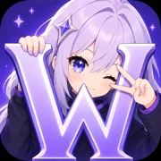
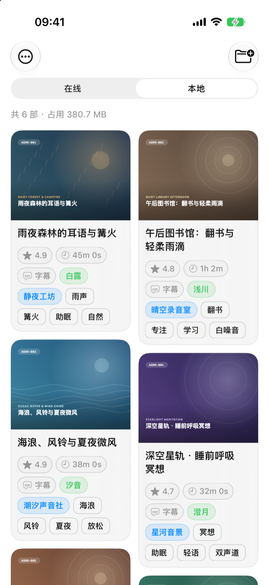
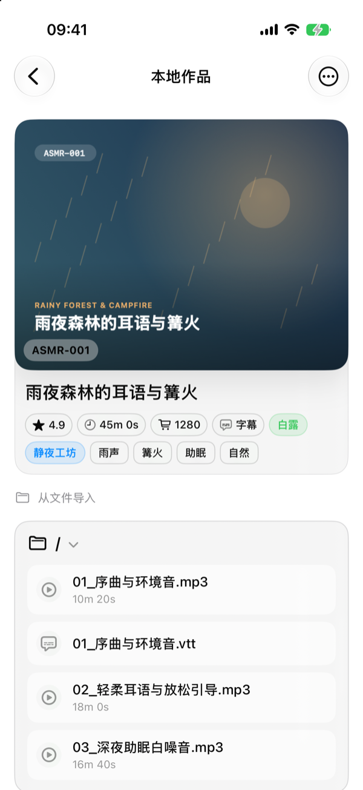
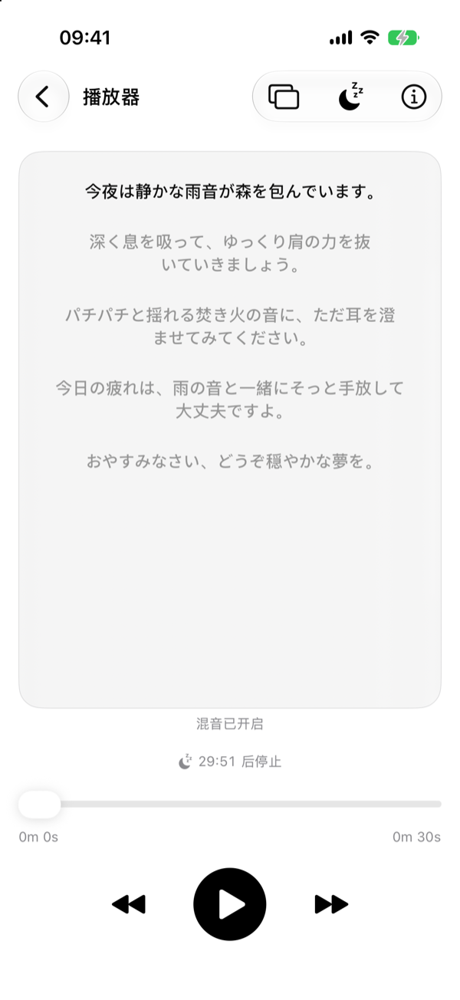
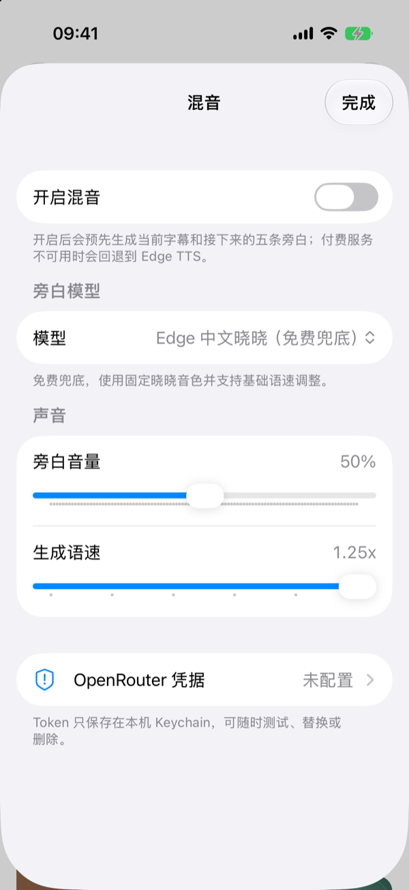

<div align="center">



# Wisimi

**A native SwiftUI iOS ASMR player**  
Supports [asmr.one](https://asmr.one) online browsing and local folder imports, with real-time subtitle sync and AI Chinese TTS narration

[](https://github.com/wsmbsbbz/Wisimi/releases)
[](https://developer.apple.com/ios/)
[](https://developer.apple.com/xcode/swiftui/)
[](LICENSE)

[简体中文](README.md) · [Features](#features) · [Screenshots](#screenshots) · [Local Import](#local-import) · [Development](docs/DEVELOPMENT.md) · [Changelog](CHANGELOG.md)

</div>

---

Wisimi is built to provide a smooth, native mobile ASMR listening experience. Alongside full compatibility with asmr.one's catalog, it adds **real-time Chinese TTS narration**, **mixed audio/video queues**, **local folder imports**, and **background batch downloads**.

## Screenshots

| Local & Online Library | Work Detail & Recommendations | Player & Live Narration | Narration & Mix Settings |
| :---: | :---: | :---: | :---: |
|  |  |  |  |

## Features

### 1. Real-Time AI Chinese Narration
- **Out-of-the-Box**: Reads VTT / LRC subtitles and overlays Chinese TTS narration on top of the original audio (free fallback powered by Edge Read Aloud).
- **Custom OpenRouter Voices**: Bring your own OpenRouter Token to use `minimax/speech-2.8-turbo`, `minimax/speech-2.8-hd`, or `google/gemini-3.1-flash-tts-preview`.
- **Fine-Grained Controls**: MiniMax provides 6 curated ASMR-friendly female voices, 0.5x–2.0x speed, expression presets, and inline cues (pauses, breaths, sighs, humming), automatically falling back to the free service on error.

### 2. Native Media Playback & Subtitles
- **Mixed Audio & Video Queue**: Audio tracks and MP4 videos in the same directory form a unified queue with previous/next controls, accurate seeking, progress restoration, and lock-screen playback controls.
- **Video & Plain-Text Reader**: Aspect-fit MP4 playback with fullscreen mode, independent subtitle drawer, and background audio when navigating back; built-in reader for `txt`, `vtt`, `lrc`, `srt`, `md`, and `log` with automatic UTF-8 / Shift-JIS / GB18030 detection.
- **Interactive Subtitles**: Highlights active lines in real time; tap any line to seek, or long-press to copy titles, tags, voice actors, circles, and subtitles.
- **Sleep Timer**: Stop playback (along with narration) after 15 / 30 / 60 minutes or at the end of the current track.

### 3. Offline Downloads & Local Library
- **Batch Background Downloads**: Multi-select or recursively select folders to download media along with matching subtitles and images; single files become playable as soon as they finish.
- **Unified Local Library**: Downloaded works and folders imported from the Files app live together in the **Local** masonry grid, with a global download bar (pause all, resume all, retry failed) and storage summary.
- **Automatic Metadata**: Automatically parses audio duration on import and fetches metadata when an RJ catalog code is detected.

### 4. Discovery & Organization
- **Browse & Search**: Explore latest, popular, recommended, favorite, and playlist works; search by title, tags, voice actors, circles, RJ codes, and subtitle availability.
- **Account Sync**: Sign in to asmr.one (token stored in iOS Keychain) to mark listening status and manage playlists.
- **In-Page Similar Works**: Browse similar works directly inside the detail page without interrupting your playback queue.

## Local Import

Switch to **Local** on the home screen and tap **Import**, then select a work folder. Wisimi copies supported audio (MP3, M4A, AAC, WAV, FLAC, AIFF, CAF), MP4 video, subtitles (VTT / LRC), plain text, and images while preserving relative folders.

You can optionally place a UTF-8 `wisimi.json` file in the root of the folder (all fields optional):

```json
{
  "title": "Rainy Forest & Campfire",
  "circle": "Quiet Night Studio",
  "duration": 2700,
  "rating": 4.9,
  "sales": 1280,
  "catalogCode": "ASMR-001",
  "tags": ["Rain", "Campfire", "Sleep"],
  "voiceActors": ["Hakuro"],
  "cover": "cover.png"
}
```

## Requirements

- **Runtime**: iOS 27.0+
- **Build**: macOS 27 + Xcode 27 (pure SwiftUI, zero external code dependencies)

See **[Development & Verification Guide](docs/DEVELOPMENT.md)** for CLI builds, automated test/coverage scripts, and offline debug fixtures.

## Privacy & License

- Imported files, downloads, and metadata are stored locally in `Application Support/LocalWorks` (excluded from iCloud backup).
- Account tokens and OpenRouter credentials are stored exclusively in the iOS Keychain.
- App source code is licensed under **MIT** ([LICENSE](LICENSE)); Edge v2 signature files are licensed under **LGPL-3.0** ([THIRD_PARTY_NOTICES.md](THIRD_PARTY_NOTICES.md)).
